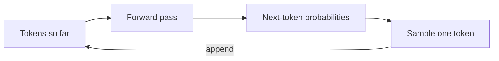

An LLM's forward pass is a single function: **sequence of [Tokens](/ai-field-guide/concepts/tokens/) → probability for every possible next token.** Generation is a loop:

It stops when the model emits a stop token or hits a length limit.

## Consequences
- **The model commits as it goes.** Every token it writes constrains what comes next. An early wrong turn tends to get justified rather than corrected, which is one reason [Test-time compute](/ai-field-guide/concepts/test-time-compute/) helps.
- **Output length costs time.** Each generated token is a separate forward pass, so long outputs are slow even when the input is cached ([KV cache](/ai-field-guide/concepts/kv-cache/)).

Related: [Sampling and temperature](/ai-field-guide/concepts/sampling-and-temperature/).
